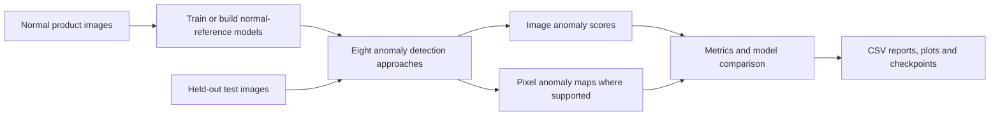

# Industrial Anomaly Detection | Eight-Model Deep Learning Benchmark

**Can a computer spot a manufacturing defect when it has mostly learned what a *good* product looks like?**

Imagine a production line that makes metal nuts. A camera takes a picture of each nut, but the defects are not always the same: one part is scratched, another is dented, and a third looks normal. Teaching a model every possible defect is difficult. This project investigates a different approach: **learn patterns in normal images, then flag unusual products and highlight suspicious regions.**

This offline research benchmark studies that question across **eight anomaly-detection approaches**. It compares *detection* (is this item suspicious?), *localization* (where is the unusual region?), and runtime and resource trade-offs.

> **Scope:** research prototype and comparative experiment — **not** a deployed factory inspection system, real-time camera service, or production-certified detector. Several implementations are simplified, paper-inspired baselines. The supplied historical results are not independent validation of performance.

## Start here: download and use the project

**What you get:** a Jupyter notebook that trains and compares eight research models. This repository does not contain a ready-to-use defect-scanning app, a trained model, or the MVTec images. You run the notebook locally after obtaining the dataset.

1. **Download the code.** On this GitHub repository page, select **Code → Download ZIP**, then extract the ZIP. If you use Git, select **Code**, copy the HTTPS URL, and run `git clone <repository-url>` instead. Open a terminal *inside the extracted repository folder*; it is the folder containing `README.md` and `requirements.txt`. [GitHub's archive instructions](https://docs.github.com/en/repositories/working-with-files/using-files/downloading-source-code-archives) explain the ZIP option.
2. **Install Python 3.11 or 3.12 and dependencies.** Follow the platform commands in [Install](#1-install) below. A compatible PyTorch/TorchVision installation may require the selector on the [official PyTorch install page](https://pytorch.org/get-started/locally/), especially for an NVIDIA GPU.
3. **Get MVTec AD separately.** Download it from the [official MVTec page](https://www.mvtec.com/research-teaching/datasets/mvtec-ad) and extract the 15 category folders directly under `datasets/mvtec_ad/`. See [Dataset setup](datasets/README.md). The source archive alone cannot run the experiment.
4. **Check the data, then open the notebook.** Use the commands in [Train, evaluate and compare](#3-train-evaluate-and-compare). Run cells from top to bottom. The first full run can take substantial time and memory.
5. **Read your outputs.** Open `results/Master_Model_Comparison.csv` for the comparison. Each model also writes its own metrics and plots under `results/`. These files describe *your local run*; they are not certified manufacturing performance.

For a quick code check that does not require the dataset, run the commands in [Check the implementation](#4-check-the-implementation) after installing dependencies.

## The problem → the proposed approach → the output

1. **Problem:** inspecting thousands of manufactured items manually is repetitive; rare, varied defects are difficult to represent with labeled examples.
2. **Approach:** train research models on normal MVTec AD images, score held-out images for unusual appearance, and compare eight techniques under a shared evaluation workflow.
3. **Output:** per-image anomaly scores, pixel-level anomaly maps where supported, quality metrics, inference-time measurements, exported comparisons and optional saved checkpoints.

### A factory example

A camera photographs a metal nut with a tiny scratch. A model trained on acceptable examples produces an **anomaly score** and possibly a **heatmap** concentrated around the scratch. A future production system could use a threshold calibrated on separate normal validation examples to flag the part for a human inspector. This project implements the **offline model-evaluation portion** of that story; the camera, production threshold, and automated reject mechanism are **not included**. Its current threshold calibration reuses normal training images, so it is not independent validation.



## What I implemented

| Model | Core idea | This repository's implementation |
|---|---|---|
| **Autoencoder** | Reconstruct normal images; reconstruction error can indicate novelty | Convolutional reconstruction baseline |
| **GAN** | Learn normal-image reconstruction with an adversarial component | Simplified GAN-inspired anomaly model |
| **DRAEM** | Learn to identify synthetic anomalies | Simplified reconstruction + segmentation approach |
| **CutPaste** | Learn discriminative features from synthetic image patches | Image-level detector; its pixel map is uniform, **not localization** |
| **PatchCore** | Compare image patches with a memory of normal features | Pretrained feature extractor with randomly sampled memory bank, **not the canonical coreset** |
| **FastFlow** | Model distributions of extracted visual features | Simplified feature-flow baseline |
| **CFLOW** | Analyze learned features with coupling flows | Simplified flow approach, **not canonical conditional CFLOW** |
| **Hybrid** | Combine complementary reconstruction and patch features | Equal-weight Autoencoder + PatchCore anomaly-map fusion |

**Shared pipeline:** PyTorch and TorchVision for models; a combined-category MVTec AD training/test loader; image preprocessing to 256×256; separate image/pixel anomaly thresholds derived from normal training images; AUROC and other research metrics; comparison CSVs and plots. See [methodology and limitations](docs/technical-review.md).

## What the benchmark tells us — and what it does not

The original supplied notebook contained saved results from **multiple runs**, including inconsistent Hybrid summaries. Its old thresholding used **test labels** and therefore could bias classification metrics. The cleaned notebook removes the old outputs and revises thresholding, but **it has not been retrained and benchmarked end-to-end against the full dataset**.

- **Technical learning:** a model can produce a promising-looking localized heatmap while still ranking *whole images* poorly. Localization and image classification must be evaluated separately.
- **Engineering learning:** evaluation leakage, test-set handling, score normalization, metric definitions and reproducibility matter as much as selecting an algorithm.
- **Open questions:** does category-specific training help? Can a proper validation split and calibrated score fusion improve reliable image detection? How much does performance vary across seeds and devices?

See [historical notebook results and caveats](docs/observed-results.md) for the actual recorded figures. **Do not interpret them as verified leaderboard rankings or industrial accuracy claims.**

## Run the project

### 1. Install

Use **Python 3.11 or 3.12**, sufficient memory, and optionally a supported NVIDIA GPU. Install the matching PyTorch build for your hardware if needed. Run these commands in the repository root. If your system calls Python `py` or `python3`, substitute that command for `python`.

**Windows PowerShell** (no activation required):

```powershell
python -m venv .venv
.\.venv\Scripts\python.exe -m pip install --upgrade pip
.\.venv\Scripts\python.exe -m pip install -r requirements.txt
```

For the steps below on Windows, use `.\.venv\Scripts\python.exe` wherever a command says `python`, and `.\.venv\Scripts\jupyter.exe` wherever it says `jupyter`.

**macOS/Linux:**

```bash
python3 -m venv .venv
source .venv/bin/activate
python -m pip install --upgrade pip
python -m pip install -r requirements.txt
```

### 2. Obtain the dataset — not stored in Git

Download **MVTec AD** from the [official dataset page](https://www.mvtec.com/research-teaching/datasets/mvtec-ad) or the [original notebook's Kaggle mirror](https://www.kaggle.com/datasets/ipythonx/mvtec-ad). Review the dataset's **CC BY-NC-SA 4.0** terms before use.

Extract the category folders to **`datasets/mvtec_ad/`** (ignored by Git):

```text
datasets/
├── README.md                 # Data access, schema, licensing — committed
└── mvtec_ad/                 # Download yourself — NOT committed
    ├── bottle/
    │   ├── train/good/
    │   ├── test/good/
    │   ├── test/broken_large/
    │   └── ground_truth/broken_large/
    ├── cable/
    └── ...                   # Remaining MVTec categories
```

Check your local extraction:

```bash
python scripts/check_dataset.py datasets/mvtec_ad
```

In Windows PowerShell, run `.\.venv\Scripts\python.exe scripts/check_dataset.py datasets/mvtec_ad`.

This is also the notebook's default path. You can store the dataset **outside the repo** and set `MVTEC_ROOT` to its folder. See [dataset setup](datasets/README.md).

### 3. Train, evaluate and compare

From the repository root:

```bash
# Only if data is at a custom location, set MVTEC_ROOT first:
# PowerShell: $env:MVTEC_ROOT = 'D:\datasets\mvtec_ad'
# macOS/Linux: export MVTEC_ROOT=/path/to/mvtec_ad
jupyter notebook notebooks/anomaly_detection_benchmark.ipynb
```

In Windows PowerShell, launch with `.\.venv\Scripts\jupyter.exe notebook notebooks/anomaly_detection_benchmark.ipynb`.

Run the notebook cells **top to bottom**. The defaults include `img_size=256`, `batch_size=32` and `epochs=5`. ResNet-18 pretrained weights may download the first time they are needed. Training all eight models takes significant time and memory; no execution-time or accuracy guarantee is made.

To try one baseline first, run the setup cells through **PIPELINE RUNNER & COMPARISON EXPORTER**, then run the two **Autoencoder** cells. Stop there and inspect `results/Autoencoder/` and `results/Master_Model_Comparison.csv`. The later model cells are optional for this first check. Run the final comparison-chart cells only after at least one model has produced metrics.

The notebook writes generated artifacts into **`results/`** (ignored by Git):

- `Master_Model_Comparison.csv` — collected model results from the current run
- Per-model metric CSVs and visualizations — anomaly maps, plots and confusion matrices
- `.pth` checkpoints — generated locally; load only checkpoints you trust

### 4. Check the implementation

```bash
python -m pytest -q
python scripts/audit_repository.py
```

In Windows PowerShell, use `.\.venv\Scripts\python.exe -m pytest -q` and `.\.venv\Scripts\python.exe scripts/audit_repository.py`.

The tests cover notebook structure and syntax; they are **not substitutes for end-to-end model training or accuracy validation**.

### If setup fails

| Symptom | Check |
|---|---|
| Dataset folder not found | Confirm `datasets/mvtec_ad/bottle/train/good/` exists. Avoid an extra nested folder after extraction. Set `MVTEC_ROOT` to the folder containing `bottle/`, not to `bottle/` itself. |
| `ModuleNotFoundError` in Jupyter | Start Jupyter from the `.venv` created above and select that Python environment as the notebook kernel. |
| PyTorch/TorchVision import or GPU error | Install a compatible pair using the [official PyTorch selector](https://pytorch.org/get-started/locally/). CPU use is possible but slower. |
| Out of memory | Lower `batch_size` in the notebook's `CONFIG` cell, close other GPU programs, or run one model at a time. |
| A pretrained weight download fails | Check internet access for the initial TorchVision weight download; rerun once the weights are available locally. |

## Repository map

```text
notebooks/anomaly_detection_benchmark.ipynb  Eight-model experiment
datasets/README.md                          How to obtain data; license and layout
docs/observed-results.md                    Historical observations and conflicts
docs/technical-review.md                    Audit findings, fixes and limitations
scripts/check_dataset.py                    Validate local folder layout
scripts/audit_repository.py                 Pre-publication privacy/secret scan
scripts/publish_github.ps1                  One-time helper for a new repository; not needed to run or update this one
tests/test_notebook_structure.py            Structural and syntax tests
requirements.txt                            Research environment dependencies
```

## Continue developing this benchmark

The notebook is the current implementation. It has no command-line training entry point or prediction API. Start with a copy of the notebook and keep the original results as historical context, not a performance target.

1. **Reproduce one baseline first.** Record the dataset version, Python and package versions, hardware, seed, category, and the generated `results/` files. Run the Autoencoder before trying all eight models.
2. **Fix the evaluation design before comparing models.** Split normal images into distinct training and calibration sets. Keep test images for final evaluation only. Report each MVTec category separately and repeat with multiple seeds. See [technical review](docs/technical-review.md) for the known methodological gaps.
3. **Make one change at a time.** Model definitions are in the named notebook cells; shared data loading, `train_model`, `calibrate_thresholds`, `evaluate_framework_model`, and the CSV exporter are separate cells. Add a new method by implementing the `BaseAnomalyModel` interface and pairing a training cell with an evaluation cell. Match its image score and pixel map to the evaluator's expected shapes.
4. **Verify the change.** Run `python -m pytest -q`, then a small local experiment and a complete held-out evaluation before claiming improved accuracy. Add a test for any extracted reusable function. Document new settings and limitations in this README and `docs/technical-review.md`.
5. **Build a client-facing tool only after validation.** A future application needs a stable inference interface, saved model and preprocessing metadata, a separate threshold calibration process, camera integration, monitoring, human review, and tests on the client's own data. The MVTec license does not grant commercial dataset use; obtain appropriate rights for commercial work.

The code has no general open-source license at present. Contact the repository owner before reusing or redistributing it in another project.

## Limitations, data ethics and code rights

This work is **research code**. It does not include live video processing, an inference API, industrial deployment, independently reproduced model accuracy, or a canonical implementation of every named paper. Category-specific validation, a genuinely held-out calibration split, correct official AUPRO evaluation, confidence intervals, and production tests remain future work. See [technical review](docs/technical-review.md).

The **dataset is not included**: MVTec AD is copyrighted by MVTec Software GmbH and licensed under [CC BY-NC-SA 4.0](https://creativecommons.org/licenses/by-nc-sa/4.0/), which restricts commercial use. Obtain it from the [official page](https://www.mvtec.com/research-teaching/datasets/mvtec-ad) and honor its terms.

Related references: [MVTec AD, Bergmann et al. (CVPR 2019)](https://www.mvtec.com/research-teaching/datasets/mvtec-ad) · [Anomalib](https://github.com/open-edge-platform/anomalib) · [Innat's separate Kaggle Anomalib tutorial](https://www.kaggle.com/code/ipythonx/mvtec-ad-anomaly-detection-with-anomalib-library) (linked for attribution, **not redistributed**).

**Source-code license:** no general open-source license is granted here until ownership and third-party code rights are confirmed. GitHub visitors can browse and download the public source, but redistribution and modification rights are a separate question.
